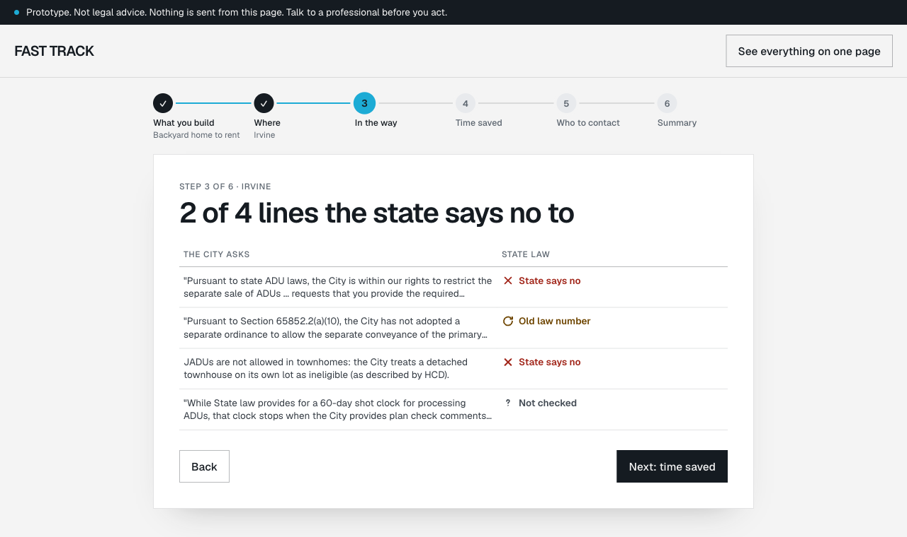

# Fast Track

> You own the lot and want to build a backyard home (ADU) or split the lot (SB 9). Fast Track checks the city's requirements against state law, line by line, shows what stands in the way with the source, lays out your legal clocks and next steps, and drafts the reply you send yourself.

**Team:** Fast Track
**Members:** Giuseppi, Johnny, Ivy, Joy
**Lane:** 2 Clear it
**Built at:** Claude Impact Lab: UCI × SoCal Affordable Housing, November 7, 2026

**Prototype only. Not legal advice. Talk to a professional before you act. Fast Track never sends anything to a city or a person.**

## The real user

**Who it is for.** First, the owner of a lot who wants to add homes on it and is blocked by a requirement the state says a city cannot impose. That can be a homeowner, a small builder, or a nonprofit that already owns the land (for example Habitat for Humanity of Orange County, the event's sponsor). Second, the city permit tech who wants to answer correctly. The people who benefit in the end are local workers (teachers, nurses, firefighters) who can move in sooner.

**The problem.** Workers cannot afford to live in Orange County. The event brief says a new affordable home takes about four years. California has fast paths where a city must say yes if the project meets the written rules, with no hearing. But each Orange County city writes its own checklist, and some checklists do not match state law. The state housing department sends cities letters about this, but those letters sit in a separate state dashboard, away from the forms applicants fill out.

**Before:** the applicant gets a city checklist or email, cannot tell which lines are lawful, and has no easy way to find the state's letter on the same point.
**After:** Fast Track marks each line, shows the state source and date, shows the review deadlines the law sets, names which office handles each issue, and drafts a response the applicant can send themselves.

**The people described here are made up.** Our personas (city permit tech, small builder, ADU homeowner, nonprofit project manager) come from public research, not interviews. We have not tested the tool with real users.

### Terms used in this README

| Term | Plain meaning |
|---|---|
| ADU | Accessory dwelling unit: a small extra home on a lot, such as a backyard cottage |
| JADU | Junior ADU: a small unit made from space inside a home |
| HCD | The California Department of Housing and Community Development, the state housing agency |
| Ministerial approval | If the project meets the written rules, the city must approve it. No hearing, no judgment call |
| SB 9 | A state law that allows duplexes and lot splits on many single-family lots |
| Gov Code | California Government Code, the state law book |

## What we built

A guided flow, one card at a time, in Habitat for Humanity of Orange County's colors:

1. **What are you building?** A backyard home to rent, a backyard home to sell, or a duplex or lot split (SB 9). Pick a card and the next one slides in.
2. **Where?** Irvine, Anaheim, Dana Point or Orange. A city with no saved list for that choice is greyed out, and so is unincorporated county land (not covered yet).
3. **What stands in the way.** Fast Track walks through the city's requirements one line at a time, then shows a two-column table: what the city asks, and what state law says (State says no, Old law number, Not checked, Allowed). Click a row for the reason and the dated sources.
4. **Time saved.** Two bars on one scale: the event brief's typical path (rezoning, entitlements, plans, build; about 45 months, all ASSUMPTION) and the fast track (no rezoning or hearings, the legal review deadlines with their sources, plans and build). The difference is labelled an estimate.
5. **Who to contact.** The city office for each issue, and HCD's Housing Accountability Unit if the city will not fix it, each with its source.
6. **Summary.** Lines checked, lines the state says no to, months saved (estimate), your legal clocks and who to contact.

"See everything on one page" opens the full dashboard, which also drafts a letter to the city and a request to HCD, and has a box that checks any city's wording you paste in.

Each line gets one of four flags. The screen uses plain words:

| Flag | On screen | Meaning |
|---|---|---|
| OK | Allowed by state law | State law allows the city to require this. The source is cited |
| CONFLICTS | State says no | State law, or HCD in its letter to that city, says the city cannot require this. The statute or letter is cited, with any limits HCD noted |
| OUTDATED_CITATION | Old law number | The city cites an old law section. The renumbering is shown |
| UNKNOWN | Not checked | Our rules do not cover it. We say so and do not guess |

Every flag shows its source, a section number and the date we checked it. The applicant reads any draft letter, edits it and sends it themselves.

**Example (real).** Irvine told an applicant it could require a deed-restriction covenant on an ADU. In its letter to Irvine of 2025-03-27, HCD found this is "an additional standard" that state law bars (Gov Code 66315). Fast Track flags that line CONFLICTS and cites the statute and the letter.

```text
$ npm run check irvine
CONFLICTS
  item irv-01: "Pursuant to state ADU laws, the City is within our rights to restrict the separate sale of ADUs ...
  rule: adu-deed-restriction
  - Gov Code 66315 (not yet checked on leginfo) https://leginfo.legislature.ca.gov/... checked 2026-11-07
  - HCD letter to the City of Irvine, 2025-03-27 (p. 1, 3) https://www.hcd.ca.gov/... checked 2026-11-07
OUTDATED_CITATION
  item irv-02: "Pursuant to Section 65852.2(a)(10), ...
UNKNOWN
  item irv-04: "While State law provides for a 60-day shot clock for processing ADUs, that clock stops when ...
```

(Output shortened. Run the command to see all items and every link.)



**Live demo:** none hosted. It runs on a laptop with the steps in [Try it](#try-it).

## How Claude is used

**To build it.** Claude helped us research the problem and the competitors, plan the build, write the code and the tests, and draft these docs. People on the team reviewed and merged the work.

**Inside the tool.** The engine is deterministic: it matches each requirement's wording against a hand-written rule set in `data/rules/`, and every rule points to a source. That is on purpose, so the tool cannot invent a law. No API key is needed to run it, and by default the app makes no Claude calls.

**Optional, off by default.** Started with `FT_CLAUDE=1 npm run dev` on a machine logged in to Claude Code, the dev server adds two routes (`vite-plugins/claude-route.ts`, `src/assist/`) that run `claude -p` with no tools: one explains a flagged line in plain words, one orders the city's results into a plan. Claude never decides a flag and never writes a citation. Each point must name a rule the engine already matched for that line; text with a section number, a code name or a link is dropped; text with a number that is not already in the engine's data is dropped; and the citations shown always come from the engine. Anything that fails these checks falls back to the engine's own text. These routes are not shown on the main screen yet.

**What a person checks.** The team read each rule against the HCD letter and Handbook text. The applicant should check the draft letter, and a professional should check anything they act on.

## Try it

You need Node 24 (see `.nvmrc`) and git. No API key and no account are needed.

```bash
git clone https://github.com/JohnFok119/fast-track.git
cd fast-track
npm install              # versions are pinned in package.json
npm run dev              # opens at http://localhost:5173
npm run check irvine     # same check in the terminal, with sources
npm run check anaheim
npm test                 # runs the test suite
```

- `.env.example` lists one optional variable, `ANTHROPIC_API_KEY`. The demo does not use it. Leave it empty.
- Sample data is in the repo: `data/cities/` (saved city requirements), `data/rules/` (the rule set) and `data/samples/` (labelled sample runs).
- `npm run verify` runs the type-check, lint and tests together.

## Sources and assumptions

All dates checked: 2026-11-07. The source list lives in `data/sources/index.json`.

| Item | Source or assumption | Date checked |
|---|---|---|
| HCD letter to the City of Irvine (2025-03-27) | https://www.hcd.ca.gov/sites/default/files/docs/policy-and-research/ordinance-review-letters/irvine-adu-ta-032725.pdf | 2026-11-07 |
| California ADU Handbook, HCD, March 2026 | https://www.hcd.ca.gov/sites/default/files/docs/policy-and-research/adu-handbook-update.pdf | 2026-11-07 |
| Gov Code 66315 (no extra standards on ADUs) | https://leginfo.legislature.ca.gov/faces/codes_displaySection.xhtml?lawCode=GOV&sectionNum=66315 (read on a mirror site, leginfo check pending) | 2026-11-07 |
| Gov Code 66317 (review clocks) | https://leginfo.legislature.ca.gov/faces/codes_displaySection.xhtml?lawCode=GOV&sectionNum=66317 (read on a mirror site, leginfo check pending) | 2026-11-07 |
| Gov Code 66333(c) (JADU deed restriction) | https://leginfo.legislature.ca.gov/faces/codes_displaySection.xhtml?lawCode=GOV&sectionNum=66333 (read on a mirror site, leginfo check pending) | 2026-11-07 |
| Anaheim ADU checklist, November 2025 | https://www.anaheim.net/DocumentCenter/View/35053/Accessory-Dwelling-Unit-Submittal-Requirements-Checklist (form Z412, quoted word for word) | 2026-11-07 |
| HCD letter to the City of Dana Point (2023-04-17, SB 9) | https://www.hcd.ca.gov/sites/default/files/docs/planning-and-community/HAU/Dana-Point-TA-041723.pdf | 2026-11-07 |
| HCD letter to the City of Orange (2026-05-05, SB 9) | https://www.hcd.ca.gov/sites/default/files/docs/planning-and-community/HAU/orange-ta-050526.pdf | 2026-11-07 |
| City of Irvine ADU page (submittal list, paraphrased) | https://cityofirvine.gov/node/69676 | 2026-11-07 |
| "A new affordable home takes about four years" | ASSUMPTION: the event brief's baseline. We did not measure it | n/a |
| Typical path phases: rezoning about 1 year, entitlements and hearings about 1 year | ASSUMPTION: the event brief's typical estimates (starter repo, `lanes/2-clear-it/data/timeline.json`). We did not measure them | n/a |
| Plans take 6 to 12 months; building takes about 1 year | ASSUMPTION: the event brief's typical estimates (starter repo, `lanes/2-clear-it/data/timeline.json`). We did not measure them. Shown as "Estimate" on the timeline | n/a |
| Review clocks: 15 business days to check completeness, 60 days to decide | HCD ADU Handbook p. 34 and p. 11, citing Gov Code 66317(a) | 2026-11-07 |
| "About 21 months shorter (estimate)" for an ADU; "About 24 months shorter (estimate) plus an unknown review time" for SB 9 | ASSUMPTION, computed: the typical path (about 45 months) minus the fast track (plans 9 months, the middle of 6 to 12; build 12 months; for an ADU, plus the two legal clocks, about 2.7 months). Every input except the legal clocks is an event brief estimate | n/a |
| City contacts (office and role, no names) | Irvine's ADU page and Anaheim's checklist; for Dana Point and Orange, the office HCD's letter was addressed to. Listed in `data/cities/` | 2026-11-07 |

Every number we did not take from a source is labelled ASSUMPTION here and in the tool: the four-year baseline, its phases, and the plans and build estimates. The months saved in step 4 and the summary are computed from those estimates, so the screen labels them "estimate" and says they are not measured. A whole project is not the same as an ADU on land the owner already has. We have no sourced review deadline for an SB 9 lot split, so the timeline shows it as UNKNOWN.

## What is real and what is mocked

| Part | Status |
|---|---|
| HCD letter to Irvine and the HCD ADU Handbook (excerpts, names and addresses removed) | Real, working |
| Irvine's requirements, as quoted in HCD's letter | Real, working |
| Rule engine, flags, citations, CLI | Working. Deterministic, covered by automated tests that run on every push |
| Anaheim's requirement wording | Real, working: the city's November 2025 checklist, word for word. Its JADU covenant still cites Gov Code 65852.2 and 65852.22, both renumbered |
| Gov Code text for 66315, 66317 and 66333(c) | Read on a mirror site (gocodebook.com). Not yet checked on leginfo, and labelled so in the output |
| "Deemed approved" if a city misses the 60 days | The statute text (Gov Code 66317(a)(3), read on a mirror site) says so, and Handbook p. 51 agrees. Shown as UNCONFIRMED until checked on leginfo |
| Draft letters (to the city, and a technical-assistance request to HCD) | Draft text only, with a Copy button. There is no send path, and a test checks the code for one |
| Paste-text scanner | Working. Uses the statewide rules only; rules found in a letter to one city never apply to pasted text |
| Timeline and next steps | Working. Law deadlines are sourced; plans and build times are the event brief's estimates, labelled ASSUMPTION |
| Who to contact | Offices and roles, each with its source (a city page or checklist, or the HCD letter to that city). No personal names |
| SB 9 checks (Dana Point, Orange) | Working. Each check is a finding from HCD's letter to that city, so it applies only to that city. Requirements are as HCD quoted or described them |

## Where it gets things wrong

- **Wording match.** It matches on wording, so it can miss a requirement phrased in a new way, or match one it should not.
- **Small coverage.** Four cities, from one HCD letter or one checklist each. The SB 9 checks come from HCD's letters to Dana Point and Orange and apply only to those two cities.
- **Irvine's "the 60-day clock stops" claim stays UNKNOWN.** HCD's letter does not analyze it, and the Handbook points both ways (p. 36).
- **Old evidence.** Our Irvine evidence is from early 2025 and our Dana Point evidence from 2023. The cities may have changed their rules since. Irvine's current ADU page still lists a covenant (checked 2026-11-07), but we have not seen its text, so we do not claim it is the requirement HCD objected to.
- **Untested with real users.** The personas are researched, not interviewed.
- **Not legal advice.** Do not rely on a flag or a letter without a professional.
- **Dependency audit.** `npm audit` shows 10 moderate findings. All are in dev-only lint tooling (minimatch, via eslint). The shipped app has 0 (`npm audit --omit=dev`).

## Next steps

None of this is built yet. It is written for the user we would build toward next: a Habitat for Humanity of Orange County project manager who reports to leadership.

**With one more week:**
- A "Before you submit" list per city, from the submittal lists already saved (Irvine's ADU page, Anaheim's form Z412).
- Ask what is on the lot now, as well as what you will build, so the tool can point to the fastest path that needs no rezoning or hearing. The 60-day clock already depends on whether a home exists on the lot, and HCD's Orange letter turned on an ADU that was already there.
- Add more cities. Each one is a data file with its saved requirements and HCD letters, not new code. The same state law applies in every California city. The next two leads are HCD's ADU letters to Aliso Viejo (2024-06-25) and San Juan Capistrano (2024-12-06), which, by our one-line summaries, also flag ADU deed restrictions (`data/sources/hcd-other-oc-adu-letters.md`; not yet excerpted).
- Check the statute text on leginfo, then add SB 9 checks that apply in every city (Gov Code 65852.21 and 66411.7).

**With one more month:**
- A portfolio view across an organization's projects, for reporting to leadership: which ones are waiting on a city past the legal deadline, and which are blocked by a requirement HCD has objected to.
- Typical timelines observed in each city, from the state's housing element Annual Progress Report data (Table A2), shown next to the legal deadlines.
- Test with a permit tech and a project manager.

**What we will not build:** predicted permit or move-in dates with no data behind them (they would be invented numbers); volunteer or subcontractor scheduling (a separate product, and volunteer names are personal information); rezoning or use-permit workflows (the slow path this tool exists to avoid).

## Data and privacy

This project uses only public or provided data. It contains no personal information about real tenants, buyers or residents. It does not file applications or contact any city or person. HCD letter excerpts have names and addresses removed, and the raw PDFs are never committed. Test personas are made up.

## License

MIT, see the [LICENSE](LICENSE) file in this repo.
